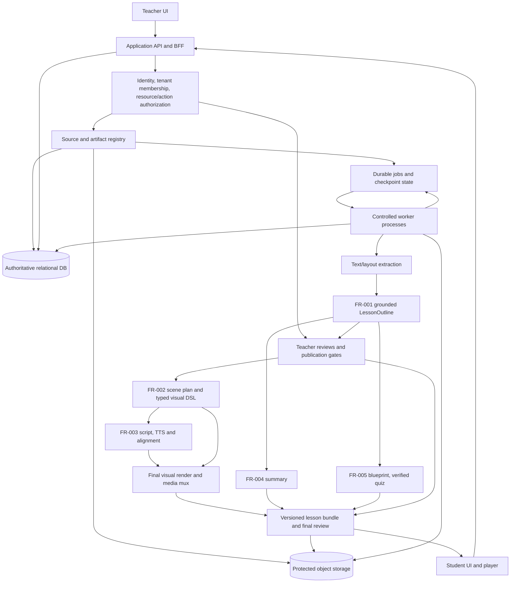
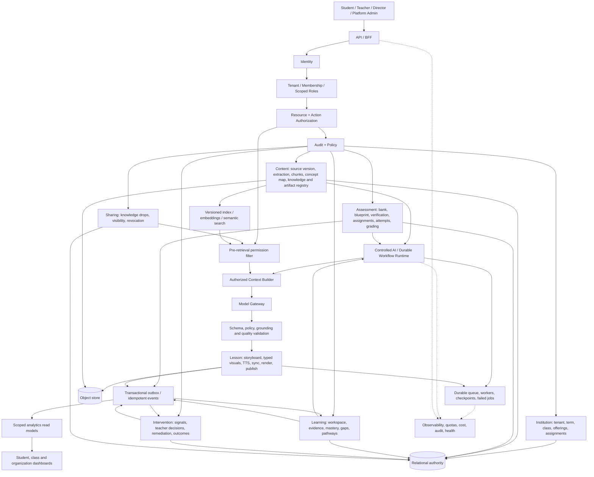

# System architecture — V4 target and first release

**Status:** planned architecture, 23 November 2026. The target is a modular monolith; the first release uses only the modules needed for a complete lesson.

## 1. Architectural decision
**Modular monolith + durable worker pool** is the planned approach. A single application codebase has clear domain boundaries and API interfaces, with separate asynchronous execution processes. No microservice split, vector database or GPU farm is required for the first release.

- **Why modular monolith?** fewer failure boundaries and deployment chores, consistent transactions, less cognitive overhead for a small team.
- **Why async workers?** video/TTS/model generation is long-running; API cannot safely wait for completion and must recover after restarts.
- **Why immutable contracts?** teacher approval, retries, audio-timing edits, quiz versions and offline bundles all require traceability to exact parent content.

## 2. P0 vertical-slice diagram

All arrows are responsibilities/data dependencies, not synchronous calls. Version gates and authorization checks recur at every sensitive transition. `JOB` and relational database may use the same initial persistence technology, but must preserve durable semantics.

## 3. V4 logical domain map

**Read correctly:** the diagram includes future FR-012–016 logical domains and RAG; the online prototype must not be described as implementing them. RAG is not required for the initial FR-001 hierarchical concept extraction. If added later, enforce resource permissions before a retrieval result enters AI context.

## 4. End-to-end immutable artifact graph
```text
SourceVersion S
  └─ ExtractedDocumentVersion E
       └─ LessonOutlineVersion O ──(teacher approval of exact O)──►
           ├─ ScenePlanVersion P
           │    └─ SceneSpecVersion V
           │         ├─ VisualSegmentsVersion R
           │         └─ ScriptVersion N ──► AudioVersion A + AlignmentVersion L
           │                                 └─ FinalRenderVersion F + CaptionVersion C
           ├─ SummaryVersion U
           └─ AssessmentBlueprintVersion B ──► QuestionSetVersion Q
                                      
PublicationVersion PUB := references {S, O, V, N, A, L, F, C, U, Q}
```
An artifact may have more than one parent (e.g., final render depends on scene spec, audio and timing); each edge stores **version ID and content digest**. Preserve model/prompt/config version, renderer build and optional assets for reproducibility. A new parent version does not mutate an older child; it marks dependent outputs stale for the *new* publication and schedules targeted regeneration.

### Publication invariant
Only an authorized user with publication rights can publish a **version-consistent** bundle. The precise `LessonOutlineVersion` must be approved by a teacher. Critical validation/security warnings block publication regardless of superficial teacher override. Final teacher review is a recommended P0 extra gate over the entire lesson and question set. A published version is immutable; rollback switches pointers to an earlier still-authorized publication rather than overwriting its bytes.

## 5. Contract boundaries and states
| Contract | Producer → consumer | Minimum stable fields |
|---|---|---|
| `SourceVersion` | Teacher/API → extraction | tenant, owner, type, content hash, source location, access policy, immutable version ID |
| `ExtractedSection` | Extractor → outline generation | source version, section/paragraph IDs, page/span, text, uncertainty and warnings |
| `LessonOutlineVersion` | FR-001 → teacher/scene/quiz | concepts, objectives, sequence, evidence refs, groundedness, exact approval state |
| `SceneSpecVersion` | FR-002 → renderer/FR-003/editor | scene order, typed entities/actions, concept refs, script intent, semantic anchors, template/assets |
| `TimingManifestVersion` | FR-003 → renderer/player | locale, scene/audio/phrase cue times, anchor alignment, asset digests |
| `LessonPublicationVersion` | Publication → student/P1 export | all parent versions, media and caption IDs, summary/quiz IDs, review metadata, entitlement |
| `QuestionSetVersion` | FR-005 → learner/attempt | published item versions and public subset; privileged answer-key store protected separately |
| `LearningEvent` | Attempts/players → FR-013/016 | actor/tenant/lesson versions, event ID, type, timestamp and validation evidence |

**Schema governance:** contracts are versioned; validate writes and reads, reject unknown major versions, provide explicitly tested migrations and converters; retain enough data to replay and audit without storing source contents in logs.

### Processing lifecycle (every long-running pipeline)
Job states: `queued → running → succeeded | retry_wait | failed | cancelled`. Store stage and review state separately. At minimum store job ID, tenant, operation, input version/digest, idempotency key/payload digest, attempt count, lease owner/expiry, next retry time, checkpoints, error class, output IDs and cost ledger. Bounded retries for transient faults, terminal failures for invalid input and permissions; do not retry a blocked authorization decision automatically.

**Effect-level idempotency:** same `(tenant, actor, operation, idempotency_key, payload_hash)` reuses logical job. Identical immutable artifact digest/version must not be published twice. A worker may repeat a model call after crash; guard downstream commits with database constraints and compare-and-set. For DB+queue consistency choose a transactional job record or outbox pattern; do not assume one HTTP request atomically commits an external queue message.

## 6. Security and trust boundaries
1. Input: enforce upload type/size/content scanning and authenticated tenant scope; text/PDF contents are untrusted **data**, not instructions to AI or code.
2. Jobs: record stable resource IDs; authorize on creation and recheck during protected reads, important worker stages and publication. Workers use scoped service identity, not arbitrary admin access.
3. AI: only pass authorized source fragments; generated JSON is parsed and schema-validated; tools are allow-listed; model has no shell or unrestricted file/network execution.
4. Media: object-store paths are private; issue short-lived authorized URLs; apply rights/attribution checks to imported images/fonts.
5. Questions: student response uses public question projection; verified keys and rubric internals restricted by action policy.
6. RAG: if present, filter by tenant/resource permissions **before ranking/prompt assembly**; embedding neighbors do not grant access.
7. Derived content: source lineage and publication status drive access checks. Offline copies and previously downloaded files cannot be instantly revoked; disclose policy.
8. Audit: record who approved/published/edited/revoked; logs contain IDs and safe metadata, not raw chapters or student answers by default.

**DEC-003 is still OPEN.** Application-side checks are required regardless of any later row-level-security decision. Cross-tenant sharing, ownership transfer, analytics privacy and revocation policy must be finalized prior to P2 release.

## 7. Async workflow and recovery architecture
Initial processing steps:
- `accept_source` → `extract` → `structure` → `analyze` → `validate_outline` → teacher approval;
- `plan_scenes` → `validate_scene` → `prepare_script` → `tts` → `align` → `finalize_timeline` → `render_segments` → `mux_and_qc`;
- in parallel with media pipeline: `generate_summary` + `build_question_blueprint` → `verify_items` → teacher review;
- `validate_bundle` → final teacher publication approval → publish.

Each stage has typed inputs/outputs, a content digest, retry policy, max attempt and heartbeat/lease when appropriate. Retry a failed render segment rather than recomputing earlier successful summaries. Retain failed-job diagnostics and give a human actionable failure code.

## 8. Persistence and events
- **Authoritative transactional state:** relational database; PostgreSQL 17.12 is the selected starting database, with schemas and indexes designed by domain ownership.
- **Binary storage:** object store for PDFs, audio, videos, captions and manifests; content-addressed naming and signed-access gate where feasible.
- **Derived read models:** optional semantic search for P2 and analytics projections; rebuildable from authoritative data/events.
- **Outbox:** event record transactionally co-committed with authoritative change; dispatcher publishes/replays; consumers dedupe by event ID and uphold at-least-once semantics.
- **Operational signals:** job/stage duration, cost/timeouts, output validation failure, approval lag, caption error, renderer resource usage and student access failures.

Suggested domain events (contracts to refine): `SourceVersionCreated`, `OutlineVersionApproved`, `SceneSpecValidated`, `MediaVersionValidated`, `QuestionSetPublished`, `LessonPublicationCreated`, `AttemptSubmitted`, `AttemptGraded`, `LessonCompleted`, `ShareRevoked`.

## 9. Technology choices and boundaries

The initial implementation uses **Python 3.13.16 + FastAPI 0.165.0**, **PostgreSQL 17.12**, **React 19.3.1 + Vite 8.3.8 + TypeScript 7.0.2** and a **Remotion 4.0.545** scene-rendering adapter. PDF extraction starts with `pdfplumber 0.11.11` and `pypdf 7.1.1`. Provider calls go through a Python interface, with `openai 3.57.0` as the first SDK integration. The selected toolchain is in [TECH-STACK.md](TECH-STACK.md); manifests are in `backend/requirements.txt`, `web/package.json` and `compose.yaml`.

Long-running tasks use PostgreSQL-backed jobs with worker leases and durable checkpoints. This avoids adding a separate broker before the project has enough load to need one. Media stays behind a storage adapter. Development may use a local directory; shared deployments require protected object storage and access checks.

The `SceneSpec` must stay independent of Remotion. The renderer is replaceable because license suitability and cross-platform behavior still need verification. Manim, Docling, Redis/Celery and a vector database are possible later additions, **not dependencies of the first build**. Model and TTS choices remain configurable.

## 10. Release checks
A "successful" video is one that is **conceptually correct, source-linked, legible, synchronized, accessible at the selected level and reviewable**, not merely an MP4 file. Execute golden-test evaluations against two different types of lesson and track defects per concept and scene. Maintain a human override without bypassing audit, security or correctness gates. See [delivery plan](DELIVERY-PLAN.md).

## References
- [OWASP LLM prompt injection prevention](https://cheatsheetseries.owasp.org/cheatsheets/LLM_Prompt_Injection_Prevention_Cheat_Sheet.html) — untrusted source/model output and tool boundary.
- [W3C WCAG 2.2](https://www.w3.org/TR/wcag/) — captions, descriptions and user-interface accessibility targets.
- [MDN WebVTT](https://developer.mozilla.org/en-US/docs/Web/API/WebVTT_API/Web_Video_Text_Tracks_Format) — timed text track syntax.
- [MDN offline PWA](https://developer.mozilla.org/en-US/docs/Web/Progressive_web_apps/Guides/Offline_and_background_operation) — offline cache behavior and limitations.
