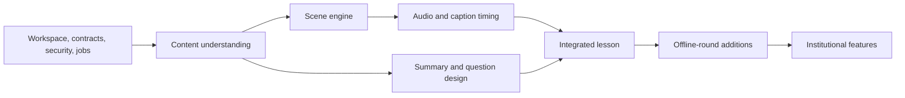

# Development plan

The first objective is a complete teacher-to-student lesson. We should be able to upload a source, approve an outline, render a short explanation, play it with narration, and answer a quiz. More institutions and more animation styles can wait until that works.

## Delivery split

| Stage | Requirements | What we show |
|---|---|---|
| **P0 — online prototype** | FR-001–005 | Teacher approval, animated lesson, audio/captions, summary, checked questions, student playback |
| **P1 — offline-round features** | FR-006–011 | Level/language variants, accessibility, checkpoints, offline export and teacher edits as permitted by event rules |
| **P2 — institution platform** | FR-012–016 | Tenant administration, learner evidence, mastery, intervention, sharing and analytics |

A quality diagram that demonstrates a concept is better than a long video of scrolling text. For the first prototype, support a small catalog of scenes rather than attempting unrestricted text-to-video generation.

## Build sequence

| Milestone | Implement | Completion check |
|---|---|---|
| **M0 — Workspace and contracts** | Install pinned stack; set up API/web code, PostgreSQL migrations, auth/membership, source/version tables, job state machine, contracts and test harness | Clean machine can install packages, run a health check, migrate DB and reject cross-tenant access |
| **M1 — Content understanding** | Upload/text/PDF parsing; sections; concepts/objectives; structured `LessonOutline`; validation; retry; teacher review | A chapter produces a grounded outline; bad PDF fails clearly; exact version approval recorded |
| **M2 — Animation** | `SceneSpec` schema; 4–5 templates; validation; Remotion renderer worker; preview and asset checks | Force/motion and a second concept each render with meaningful visual actions and no arbitrary code execution |
| **M3 — Narration and captions** | Script editing, provider TTS, timed cues, subtitles and audio-led final render | Scene timing follows audio; captions play correctly; media duration checks pass |
| **M4 — Summary and quiz** | Outline-linked notes, key facts/formulas, question blueprint, answer verification, deterministic scoring and feedback | Learner sees correct, version-matched summary and quiz; answers are hidden until response |
| **M5 — Integration and demonstration** | Teacher publish controls, student player, retries, auditing, security/quality tests, demo fixtures | Fresh account completes one lesson; restart, duplicate submission and stale-edit tests pass |

M0 introduces only the minimum roles, not the full FR-012 institution administration system. M4 summary and assessment work can begin after M1 while animation and audio are underway.

## Team workstreams

| Workstream | Owns | Depends on |
|---|---|---|
| Backend + AI | Input parsing, outlines, providers, validation and job stages | Contracts and database |
| Video + media | Scene catalog, template rendering, captions and timeline | `SceneSpec` and script/timing contract |
| Frontend | Teacher flow, review UI, video player, learner quiz | API contracts and preview artifacts |
| Database + security | Migrations, tenant checks, audit history, job leases and publication rules | Agreed authorization defaults |
| QA + integration | Golden lessons, automated regression tests, end-to-end demo | All modules |

One person may cover multiple workstreams. Share schemas early; avoid building isolated modules whose inputs and outputs do not match.

## First development session: concrete tasks

1. **Install and verify the stack** in [TECH-STACK.md](TECH-STACK.md). Confirm Python 3.13.16 and Node 24.22.3 rather than using globally installed alternatives.
2. Check Remotion's license for the actual team; if unsuitable, keep the same scene schema and use SVG/Canvas+FFmpeg.
3. Scaffold the backend (FastAPI), web (React/Vite) and renderer modules. The ZIP currently has manifests, not runnable source code.
4. Start PostgreSQL 17.12; add migrations for source versions, jobs, lesson versions and review decisions.
5. Implement a trivial `SceneSpec` with a rectangle, vector arrow, movement and text; produce a short test clip.
6. Add a fixture PDF and verify page positions and section ordering.
7. Write integration tests for artifact ID linkage and duplicate job submission before connecting paid AI calls.

Do not start with institution dashboards, semantic search infrastructure or a large scene library.

## Contracts needed before feature work

- **`SourceVersion`**: tenant/owner, content hash, media type, storage pointer, original filename and access policy.
- **`SourceSection`**: section ID/parent, page range, passage positions, text, extraction warnings.
- **`LessonOutlineVersion`**: learning objectives, concepts, evidence, prerequisites, teaching steps, confidence/grounding, schema version and teacher approval.
- **`SceneSpecVersion`**: allowed primitive/template names, object IDs, actions, concept IDs, evidence refs, narration anchors and asset refs.
- **`NarrationTimelineVersion`**: locale, script/audio IDs, actual duration, timed cues and caption file.
- **`AssessmentVersion`**: question/rubric, concept refs, verified key, explanation, visibility and version link.
- **`PublicationManifest`**: exact versions of all assets delivered to a student.

Represent these with Pydantic and TypeScript types derived from shared JSON Schema/OpenAPI definitions. A generated file is not published until its parent version and access rights are checked.

## Test lessons and quality checks

Start with at least two lessons that require different visuals:

- **Physics:** Newton's Second Law, with vector arrows, labels and fixed-mass/variable-force demonstrations.
- **Science or computer science:** a water-cycle process flow or a queue/stack operation animation with step-by-step state changes.

Keep the original source, intended concepts, expected diagrams, quiz answers and any known extraction hazards as golden fixtures. In tests, intentionally introduce a wrong arrow direction, incorrect units, missing source text, badly timed captions, and a wrong answer key. The pipeline should reject or flag these cases rather than silently rendering them.

Track factual correctness, objective coverage, extraction warnings, scene readability, actual narration drift, render duration, retry counts and spend. Set numerical pass thresholds only after the first runs provide evidence.

## Main risks

| Risk | Early sign | Response |
|---|---|---|
| Generated scenes look like slides | Most scenes only reveal text | Require at least one verified visual mechanism per lesson; limit topic range |
| Incorrect educational claims | Concept/source conflict or wrong math | Use evidence refs, domain rules and teacher review |
| Render time or API cost spikes | Multiple long re-renders/retries | Scene caching, short test clips, budgets, capped retries |
| Source versions get mixed | Summary or quiz describes an older lesson | Immutable IDs, dependency graph and publication gate |
| Permission leak | Protected video URL still works after revocation | Private storage, short-lived access, recheck at read/publish |
| Large technical stack delays delivery | Time spent deploying services not needed for the demo | PostgreSQL job queue, modular monolith, local assets until necessary |
| Renderer license does not fit | Team size/use outside free terms | Review before implementation; keep engine replaceable |

## What counts as done

A feature is done when its API/UI path works, schema and authorization tests pass, failure cases have clear results, artifacts carry version/source IDs and the demo reproduces from a clean environment. A design document or successful model response alone is not completion.

Build P1 in the order that gives the highest hackathon value: limited teacher edits, level variants, independent language tracks, broader accessibility, checkpoints and offline package. Follow actual event instructions if priorities change. Only after the core path is stable should the team grow P2's organization and learning-intelligence modules.
