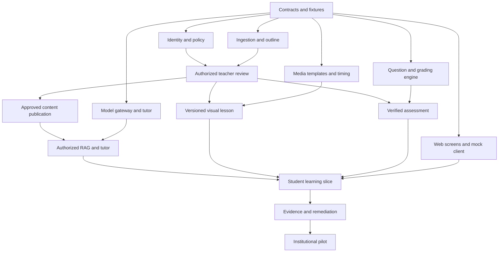

# VIORA-AI — Phase-wise engineering action plan

**Baseline:** 24 November 2026  
**Status:** Proposed implementation plan; review at kickoff  
**Scope:** Main institutional learning platform, visual-learning requirements and independent LLM evaluation integration.

This plan defines how development is split, how modules communicate and how changes reach `main`. It complements the existing [requirements](REQUIREMENTS.md), [V4 architecture](ARCHITECTURE-V4-FULL.md), [decision log](DECISIONS.md), [delivery plan](DELIVERY-PLAN.md), [technology stack](TECH-STACK.md) and [product blueprint](complete-project-detailed-end-to-end.md). The latter expands VIORA into an institution-first B2B2C platform. The original hackathon delivery plan still applies when competition deadlines require FR-001–005 first. Agree which release is due first at kickoff; do not silently drop either scope.

## 1. Engineering model

Build a modular monolith with a single FastAPI application, a role-aware React application, PostgreSQL and durable worker processes. Use private object storage for source files and media. Add pgvector when retrieval work begins. Keep the LLM evaluation project separate and integrate only through a controlled interface.

The unit of ownership is a business domain, not a technology layer or dashboard. A developer owns a module's routes, contracts, services, persistence and tests. Other developers use its published interfaces. They do not import its private repositories or modify its tables. Frontend work can begin against approved contracts and fixtures before the real backend is ready.

Use synchronous in-process calls for immediate business operations and durable jobs/events for long-running or loosely coupled work. Do not make HTTP calls from one module to another inside the monolith. No new broker, graph database or separately deployed domain service is needed until measured demand justifies it.

## 2. Module ownership and API boundaries

All product routes below are relative to `/api/v1`. Routes are proposed interface families, not implemented endpoints; exact request/response schemas must be reviewed before coding. Internal modules expose typed service interfaces rather than public HTTP routes unless a client genuinely needs them.

| Module | Route family / interface | Owns | Depends on |
|---|---|---|---|
| Identity & access | `/auth/*`, `/me`, internal policy service | Users, sessions, memberships, role grants, authorization decisions | Institution identity reference, shared DB |
| Institution | `/institutions/*`, `/classes/*`, `/subjects/*` | Tenants, academic terms, programmes, offerings, teacher assignments, enrollments, guardian links | Identity/policy |
| Content | `/sources/*`, `/outlines/*` | Sources, versions, sections, outlines, approval records | Policy, storage, job runtime, AI gateway |
| Knowledge | `/concepts/*`, internal index service | Canonical concept IDs, relationships, evidence links, chunk and index versions | Content, policy |
| Retrieval | Internal `retrieve()` interface | Hybrid ranking, authorized graph traversal, retrieval configuration | Knowledge, policy, pgvector |
| Tutor | `/tutor/conversations/*` | Conversation turns, teaching modes, citation-bearing responses | Retrieval, AI gateway, policy |
| Media & content studio | `/lessons/*`, `/renders/*` | Scene plans, scripts, summary versions, narration, timing, media artifacts | Approved outline, gateway, workers, storage |
| Publication & sharing | `/publications/*`, `/shares/*` | Published manifests, audience grants, revocations | Policy, approved content/media/question versions |
| Assessment | `/question-banks/*`, `/assessments/*`, `/attempts/*` | Questions, PYQs, tests, attempts, verified keys, results | Knowledge/content, publication policy, AI gateway |
| Learning | `/learning/*` | Evidence, mastery estimates, revision schedules, recommendations | Assessment events, knowledge, policy |
| Intervention | `/interventions/*` | Teacher decisions, remediation assignments, outcomes | Learning, institution, policy |
| Analytics | `/analytics/*` | Scoped, rebuildable read models and reports | Domain events, policy |
| Platform operations | `/platform/*` | Onboarding, plan/usage limits, operational reports, billing later | Institution, usage, audit |
| Workflow runtime | `/jobs/{id}`, internal job service | Jobs, leases, retries, checkpoints, outbox and consumer deduplication | Database, policy |
| AI gateway | Internal `generate()`, `embed()`, `synthesize()` | Provider adapters, prompt/model versions, budgets, usage records | Configuration, policy |
| Evaluation integration | `/platform/quality/*`, private adapter | Sanitized evaluation request/result references | AI gateway, external evaluation project |

Identity and institution share stable ID references, not circular service imports. Create a tenant and its first admin membership through an explicit bootstrap use case; each module retains ownership of its records. Keep guardian authorization in the central policy path. The student and teacher dashboards are compositions of these APIs, not separate copies of the same business logic.

### Module layout

```text
backend/
  app/
    main.py                     # application composition only
    core/                       # configuration, auth context, errors, logging
    db/                         # session and transaction infrastructure
    modules/
      content/
        router.py               # HTTP adapters: parse, authenticate, respond
        schemas.py              # request/response and public DTOs
        service.py              # use cases, transaction boundaries
        repository.py           # queries for owned data only
        models.py               # owned persistence models
        ports.py                # typed interfaces for external dependencies
        public.py               # published module interface
      identity/                 # same pattern, as appropriate
      institution/
      knowledge/
      rag/
      tutor/
      assessment/
      ...
    ai/                         # provider gateway and adapters
    workers/                    # shared job runtime and handler registration
  migrations/                   # coordinated Alembic revision history
  tests/                        # unit, contract, integration, security, e2e
web/
  src/features/                 # domain-specific UI and tests
  src/services/                 # generated API client and transport
renderer/                       # controlled media runtime
contracts/                      # versioned interfaces and shared fixtures
.github/workflows/              # CI gates
```

Create directories as needed; no empty module scaffolding for future features. Inside a module the dependency direction is HTTP router → application service → repository/port. Pure domain rules must not depend on FastAPI or ORM objects. Workers call the same application services, not route handlers. Composition code wires real adapters; tests substitute fake implementations of the same ports.

## 3. Contract-first development

Before implementation of a feature, agree on its route/operation ID, input/output schema, permission rule, errors, data owner, versioning rules and representative success/failure fixtures. The producer and at least one consumer review the contract PR. Agree the contract in a small PR, then implement in parallel.

- Store shared HTTP contracts as domain-owned OpenAPI fragments under `contracts/http/` with a generated aggregate checked by CI. Use a spec version supported by the selected FastAPI and client tooling; verify round-trip compatibility during bootstrap. Export implemented FastAPI OpenAPI in CI and compare it with the agreed operations. Generate frontend types/client from the contract; do not manually edit generated files.
- Use versioned JSON Schema/Pydantic contracts for jobs, events and educational artifacts. Keep each contract next to its owner or in an owner-specific contract directory. Choose one authoritative definition per interface; generated representations must not become a second source of truth.
- Return consistent typed errors (for example `code`, `message`, `request_id`, optional safe field details). Use 401 for missing/invalid authentication, 403 for denied actions where disclosure is allowed, 404 for missing or deliberately concealed resources, 409 for conflicts, 422 for invalid input, 429 for limits and 202 for accepted asynchronous jobs. Use cursor pagination for potentially large lists.
- Use opaque IDs, UTC timestamps, explicit tenant context verified against membership, immutable artifact version IDs and idempotency keys for retryable mutations. Never trust tenant/actor identifiers simply because a client submitted them.
- Prefer additive, optional changes within v1. Removing/renaming fields, changing meaning or making optional fields required requires a compatibility plan and coordinated consumer updates (new contract major/version if necessary). Add consumer tests for defaults and unknown fields. Keep generated client changes in the same contract PR or an automated follow-up.
- Keep development mocks in test/dev-only configuration. Contract-test the real producer against those fixtures. Unimplemented endpoints are not exposed as working production features; use feature flags or explicit unavailable states. Never ship auth bypass or fake success responses.

### First shared contracts

| Contract | Producer | Consumers |
|---|---|---|
| `AuthContext`, `AccessDecision` | Identity / policy | All protected API operations and workers |
| `InstitutionRef`, `SubjectOfferingRef` | Institution | Content, tutor, assessment, frontend |
| `SourceVersion`, `ExtractedSection` | Content | Knowledge, outline generation |
| `LessonOutlineVersion`, `EvidenceRef` | Content | Teacher review, media, assessment, knowledge |
| `ConceptRef`, `ConceptRelationship`, `RetrievalResult` | Knowledge / retrieval | Tutor, assessment, learning |
| `JobAccepted`, `JobStatus` | Workflow | Content, media, UI |
| `TutorResponse` | Tutor | Student workspace, evaluation |
| `SceneSpecVersion`, `NarrationTimelineVersion` | Media | Renderer, player, publication |
| `QuestionPublic`, `AssessmentResult` | Assessment | Student UI, learning, analytics |
| `PublicationManifest` | Publication | Player, retrieval access policy, offline package |
| `LearningEvidenceEvent` | Assessment / learning (agree one event owner) | Mastery, analytics, intervention |
| `EvaluationRequest`, `EvaluationResult` | Evaluation integration | Independent evaluator, internal quality UI |

For artifacts include schema version, immutable ID, source/parent version refs, validation status and provenance where applicable. Teacher review is tied to the exact outline version. Later changes require new artifact versions and invalidate incompatible downstream outputs for new publication.

### Example: upload and understanding workflow

Illustrative endpoints (tenant and offering are checked against the authenticated actor):

| Operation | API | Result |
|---|---|---|
| Upload source | `POST /sources` (multipart) | 201 with source and immutable version IDs |
| Request understanding | `POST /sources/{source_id}/versions/{version_id}/outline-jobs` | 202 with job ID |
| Get job status | `GET /jobs/{job_id}` | State, stage, safe error or output refs |
| Read generated outline | `GET /outlines/{outline_version_id}` | Typed draft plus evidence and warnings |
| Approve outline | `POST /outlines/{outline_version_id}/approvals` | Exact-version review record |
| Start visual lesson | `POST /lessons` | 202 with generation job ID; approved outline required |

Example accepted response:

```json
{
  "job_id": "4d471b64-437b-4b56-8db3-fd14e38c39a0",
  "status": "queued",
  "status_url": "/api/v1/jobs/4d471b64-437b-4b56-8db3-fd14e38c39a0"
}
```

The content developer can implement outline processing using a fake storage and AI gateway; the media developer can render a fixture outline; the frontend developer can implement job and review screens using the agreed mock response. The real flow is integrated as each producer lands. This removes build-time waiting, not genuine runtime dependencies such as teacher approval before generation.

## 4. Persistence and asynchronous integration

Use one PostgreSQL database initially, with domain-owned tables (schema namespaces where practical). Only the owner writes its records; enforce cross-domain references and tenant integrity with suitable constraints. Read models may join authorized projections, but must not become competing sources of truth. No shared catch-all `models.py` or unrestricted SQL across domains.

Coordinate Alembic migrations through one designated migration reviewer per integration window. Feature PRs include migrations for their own data. Rebase against the current migration head before merge; CI checks for unexpected multiple heads, tests upgrade from an empty DB and upgrade from the previous baseline. Use expand–migrate–contract for destructive changes; back up and validate data before removing columns. Do not edit already applied revisions.

The current product blueprint calls for isolation at API and database levels; DEC-003 remains open. Adopt application-level policy checks immediately and propose PostgreSQL RLS on tenant-bearing protected records before pilot. Verify the policy using non-owner application roles, tenant-scoped transactions and pooled connections; avoid RLS bypass by privileged roles. Define revocation, derived media access and guardian privacy before real users. Keep cross-institution sharing and exceptional admin access disabled pending explicit policy.

Use a database-backed job queue with persisted leases, bounded retries, checkpoints and idempotent effects. Track `queued`, `running`, `retry_wait`, `succeeded`, `failed`, `cancelled`; track review separately. Use transactional outbox events when another module must react to a committed change. Consumers deduplicate by event ID and recheck access for protected data. A crash may repeat an external model call; constrain retries and prevent duplicate logical outputs rather than claiming exactly-once execution.

| Event | Producer | Consumer / effect |
|---|---|---|
| `SourceVersionCreated.v1` | Content | Ingestion workflow |
| `OutlineVersionApproved.v1` | Content | Knowledge/index preparation, media/assessment eligibility |
| `PublicationCreated.v1` | Publication | Access-scoped index visibility, student workspace |
| `AssessmentGraded.v1` | Assessment | Learning evidence, analytics |
| `MasteryUpdated.v1` | Learning | Intervention signals and analytics |
| `AccessRevoked.v1` | Policy / publication | Index invalidation, media access checks |
| `AIOperationCompleted.v1` | AI gateway | Usage and sanitized evaluation processing |

Persist event ID, tenant ID, type/version, occurred-at time, aggregate/version ID and correlation ID. Use IDs rather than raw student conversations or textbook passages in events. A draft may be indexed privately for authorized teacher review, but is not retrievable by students until publication grants permit it. Revocation checks apply even if an index update is delayed.

## 5. Parallel workstreams

Assign one primary and one reviewing owner to each workstream at kickoff. These are workstreams, not a required headcount; one developer may own several related modules.

| Lane | Ownership | First independent task | Test double / fixture |
|---|---|---|---|
| A — Platform | Identity, institution, policies, DB/job runtime, CI | Bootstrap tenant and membership contract | Two synthetic tenants and roles |
| B — Knowledge | Content, parsing, concept graph, retrieval | Parse a fixture PDF and produce sections | Fake storage, approved outline, sample chunks |
| C — AI & tutor | Model gateway, tutor strategies, evaluation adapter | Implement gateway port and tutor response contract | Fake model and retrieval results |
| D — Visual studio | Scene DSL, renderer, narration, summary | Render a hand-authored scene | Approved outline and audio fixture |
| E — Assessment & learning | Questions, attempts, grading, evidence | Grade a versioned fixture question set | Concept IDs, fake clock, result event |
| F — Web | Shared client, navigation, teacher/student feature screens | Build shell and review/upload screens | Contract-generated HTTP mocks |
| G — QA / integration | Test corpus, regression suite, end-to-end checks | Seed two tenants and golden lessons | Deterministic provider adapters |

If the team is small, combine lanes A/G, B/C, D/F or E with another lane based on availability. Preserve module ownership even when one person covers multiple lanes. Every feature owner writes its own tests; QA does not become a bottleneck. The evaluation engine itself belongs in its independent project, with an agreed integration owner in VIORA.

## 6. Phase-wise action plan

Phases are **integration/release gates**, not a rule that all developers wait for the previous phase to finish. Work downstream can start against versioned contracts and fixtures as soon as those are reviewed. Integration starts with the first completed slice and continues throughout. No calendar estimates are implied; set dates after assessing capacity and competition/pilot deadlines.

| Phase | Parallel work to deliver | Integration gate |
|---|---|---|
| **0 — Bootstrap and contracts** | A/G: clean install, lock dependencies, FastAPI, database migration, CI and tenant test harness. B–E: review initial contracts and fixtures; renderer/license spike. F: web shell and mock API client. | Clean checkout runs API/web, DB migration and CI. First OpenAPI/client check passes; ownership assigned; stack pins verified or corrected. |
| **1 — Identity and academic context** | A: auth, memberships, class/subject assignments and policy. B: source/storage adapters and parser fixtures. C: fake/real gateway adapters. D: scene templates. E: question models and scoring. F: role navigation and teacher/student mock screens. | Two synthetic tenants prove access isolation; teacher can access assigned subject, student cannot see another class. |
| **2 — Resource intelligence** | B: FR-001 text/PDF ingestion, sections, concepts, outline validation. A: durable jobs, audit, private storage. C: structured model calls. D/E: consume approved outline fixtures. F: upload, job status, teacher review screens. G: extraction and crash tests. | Real teacher uploads a chapter, job completes, review shows evidence, approval refers to exact immutable version. Failures and duplicate requests are tested. |
| **3 — Knowledge retrieval and learner/teacher slices** | B: pgvector, full-text search, RRF, source/section retrieval, typed concept edges. C: simple and guided tutor modes, citations, abstention. D: deterministic scenes, TTS/timing in parallel. E: summary-linked question blueprint and verified questions. F: resource publish/learn and tutor UI. | Student retrieves only published authorized content; direct-question benchmark passes agreed thresholds; teacher can publish approved learning material. Media and assessment slices integrate as they become ready. |
| **4 — Complete core lesson and assessment** | D: render, audio-led timing, captions, summary. E: question bank, practice/test attempt, deterministic grading. F: player, practice screens and basic teacher results. B/C: bounded graph multi-hop and teaching modes where evidence supports improvement. G: golden lesson and permission regression. | Teacher approves and publishes a version-consistent narrated animation, summary and verified quiz; student learns, submits and receives feedback. FR-001–005 satisfied for online-round scope after review. For institutional core, also demonstrate source-grounded tutor and class report. |
| **5 — Learning intelligence and offline extensions** | E: learning evidence, explainable mastery, prerequisite gaps, revision, intervention. D/F: teacher editing, level/language variants, accessibility, checkpoints, offline package and deduplicated sync. B/C: retrieval/evaluation improvements. A: scoped sharing and revocation. | Evidence-backed recommendation and teacher remediation flow; P1 extensions pass relevant FR-006–011 tests; offline revocation limitations explicit. Prioritize whichever competition or pilot release is due. |
| **6 — Institutional expansion** | A/F: HOD, institution admin/owner, guardian access, onboarding and internal ops. E/G: scoped analytics, small cohort privacy and report reconciliation. B/C/D: academic packs, PYQ workflow, model/usage reporting and quality integration. | Second institution onboarding passes isolation, authorized parent sees only linked child's permitted data, analytics reconcile. FR-012–016 and expanded blueprint features tracked separately. |
| **7 — Pilot and production** | All lanes: security, backup/restore, deployment, cost/quota limits, reliability, accessibility, licensing, support and billing; integrate evaluation release gates. | Pilot sign-off, security and privacy review, rollback/restore rehearsal, measured latency and cost, approved quality baseline. No claim of production readiness until gates pass. |

### Critical-path dependencies



The diagram shows integration dependencies, not task start dates. Publication for each resource type must satisfy the corresponding approval and validation gates. Final lesson publication includes exact approved media/summary/assessment versions.

## 7. Integration without merge bottlenecks

Use short-lived feature branches off `main`, small pull requests and frequent merges. No long-lived developer branches or final-week integration. GitHub Actions should run module tests, contract checks and a small cross-module integration suite on every PR. Use feature flags to merge unfinished but safe work; never use flags as an authorization substitute.

| Conflict hotspot | Rule |
|---|---|
| `main.py` and route registration | Integration owner maintains composition root; register one module router at a time; business code stays out of it |
| Shared API / event contracts | Producer and consumer review small changes first; CI checks compatibility and duplicate operation IDs |
| Migrations | Module owner proposes revision, migration reviewer coordinates merge order and verifies one expected head |
| `core/`, auth, shared infrastructure | Named reviewer required; avoid unrelated edits to feature-owned files |
| Dependency manifests and lockfiles | One dependency PR per change; clean install, review and regenerate lockfiles together |
| Frontend shared components | Shared UI owner reviews reusable primitives; domain screens live under feature directories |
| Generated clients | Regenerate deterministically; never merge manually edited generated types |

Use `CODEOWNERS` after assigning real GitHub usernames. Require review and successful CI through branch protection where repository permissions/plan allow it. Keep development-only secrets out of commits; run secret scanning and dependency checks. Avoid force-pushing `main`; revert defective changes or fix forward in a small PR.

A feature issue should specify owner, module, affected contract IDs, dependent consumers, acceptance tests and PR links. For each change:

1. Update local `main`, create a small branch (`feat/content-upload`, for example).
2. Merge contract changes first if consumers need them; publish fixtures.
3. Implement module behavior and tests. Open a draft PR early; keep unrelated changes out.
4. Sync with `main` before merge, resolve migrations/contract conflicts, run checks and request review.
5. Squash merge or use the agreed consistent merge policy. Delete the merged branch. Exercise the integrated feature in a shared test environment.

If tests fail after merge, prioritize restoring `main` over starting more feature work. Use synthetic data in shared environments and independent local databases for developers. Integration tests run against real PostgreSQL, not SQLite substitutes for tenant/vector behavior.

## 8. Release checks and AI quality

Each completed slice must have unit tests for domain rules, contract tests for producer/consumer compatibility, database integration tests, authorization tests and an end-to-end smoke test. Test the two-tenant deny path, revoked access, duplicated job/event, worker restart, changed artifact version and hidden answer keys. Store golden educational fixtures (e.g. stack operations and Newton's second law) with teacher-checked outcomes and source spans. Use fake models in routine CI; run representative real-provider evaluations separately with bounded budgets.

RAG begins with dense and keyword baselines, then hybrid fusion, section context and bounded graph traversal. Compare retrieval recall, answer correctness, citation support, unanswerable-query abstention, latency and cost before enabling more complexity. No unauthorized passage may reach prompt assembly. The five tutor modes share one controlled pipeline; ship simple/guided explanations first, add visual, connected knowledge, worked examples and recall as their engines mature. Do not confuse evidence-based mastery with a definitive diagnosis of ability.

Start the independent evaluation project in parallel with AI contracts. VIORA exports sanitized events/fixtures and consumes versioned evaluation reports through authenticated private integration; it does not embed the evaluator in student request handling. Release-blocking security and validation checks remain synchronous where required; expensive quality comparisons are offline or sampled asynchronously with privacy controls. Define measurable quality thresholds after initial benchmarks, before pilot release.

## 9. Kickoff checklist

- Confirm whether the next release is the hackathon vertical slice or institution pilot; agree the first subject, class, sample resources and core demo.
- Assign module owners/reviewers and a rotating integration coordinator; create issues for Phase 0 tasks.
- Approve minimum access and revocation policy for development; resolve database isolation approach before pilot. Use synthetic users until required safeguards are in place.
- Validate existing Python/npm pins from a clean install and confirm renderer licensing; add pgvector and other new dependencies only through tested changes. Do not replace the committed stack based solely on this plan.
- Review initial HTTP, artifact and event contracts; commit shared fixtures and client generation workflow.
- Establish branch review/CI checks; begin work on independent lanes immediately after relevant contracts are merged.

Open items: actual team capacity/ownership, release dates, DEC-003 policy, version compatibility, deployment target, AI providers, quality thresholds and data-handling rules. The module/route names and lane allocation in this file are proposed decisions, not implemented or previously approved interfaces. Update this file and the decision log when these choices change; maintain the FR register as the source of functional scope.

## Engineering references

- [Google Cloud API Design Guide](https://docs.cloud.google.com/apis/design) and [AIP-180: Backwards compatibility](https://google.aip.dev/180) — API boundaries and compatibility.
- [OpenAPI Specification](https://spec.openapis.org/oas/latest.html) — machine-readable HTTP interfaces; select the tool-compatible version during bootstrap.
- [DORA: Trunk-based development](https://dora.dev/capabilities/trunk-based-development/) and [Continuous integration](https://dora.dev/capabilities/continuous-integration/) — short-lived branches and rapid feedback.
- [AWS Prescriptive Guidance: Transactional outbox](https://docs.aws.amazon.com/prescriptive-guidance/latest/cloud-design-patterns/transactional-outbox.html) — durable event publication and idempotent consumption.

These references inform the practices; they do not prescribe VIORA's specific module structure or imply endorsement of the project.
